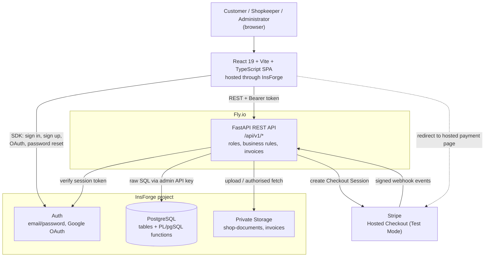
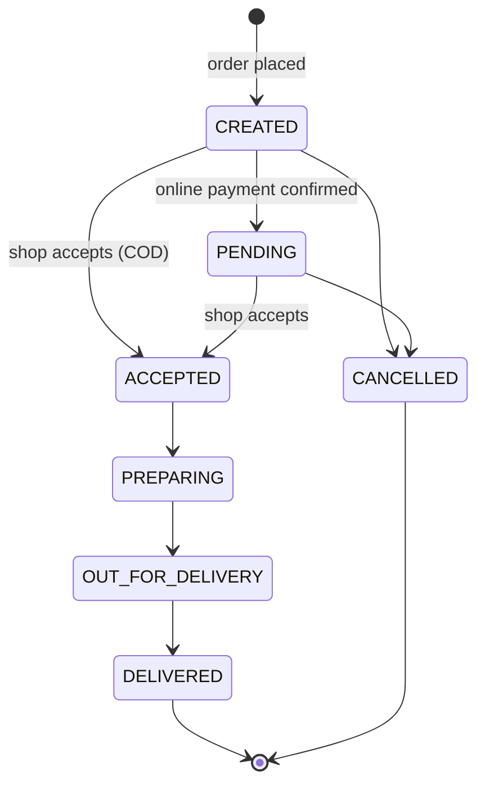
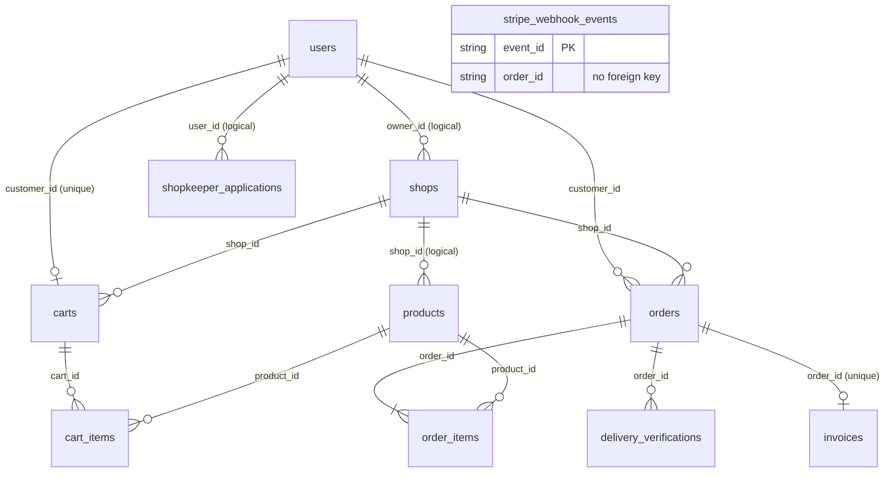

<p align="center">
  
</p>

<h1 align="center">LOCOMART — Local Grocery Assistance Platform</h1>

<p align="center"><em>Your trusted local shops, delivered to your doorstep.</em></p>

LOCOMART is a full-stack web application for ordering groceries from neighbourhood shops. Customers browse local shops and place orders, shopkeepers manage their catalogue and fulfil those orders, and an administrator reviews merchant applications. The frontend is React + Vite + TypeScript, the backend is FastAPI, and InsForge provides PostgreSQL, authentication and private file storage. Online payments use Stripe Checkout in Test Mode.

| | |
|---|---|
| **Repository** | https://github.com/ChanduChowday25/LOCOMART |
| **Live application** | https://locomart.insforge.site |
| **Backend API** | https://locomart-api-5ca4cdb8-59f8-4964-8dbd-fca39baddd17.fly.dev (`/health` for a liveness check) |

> LOCOMART is a deployed portfolio project. Payments run in Stripe Test Mode only, and the shops in the demo are seed data. See [Current Limitations and Scope](#current-limitations-and-scope).

**Contents:** [The Problem](#the-problem) · [The Solution](#the-solution) · [Screenshots](#screenshots-and-demo) · [Features](#core-features) · [Architecture](#system-architecture) · [Workflows](#main-application-workflows) · [Order and Payment Lifecycle](#order-and-payment-lifecycle) · [Tech Stack](#technology-stack) · [Database](#database-design) · [Security](#security-and-engineering-decisions) · [Project Structure](#project-structure) · [Getting Started](#getting-started) · [Environment Variables](#environment-variables) · [Utilities](#demo-data-and-administrative-utilities) · [Deployment](#deployment) · [Limitations](#current-limitations-and-scope) · [Future Ideas](#future-improvements) · [What I Learned](#what-i-learned) · [License](#license-and-contact)

---

## The Problem

A lot of families end up spread across cities. A son or daughter moves away for college or a job, while the parents stay in their hometown or village. Most of the time that works fine, but everyday errands can get awkward. An elderly parent may find a trip to the shop tiring, and asking a neighbour or a relative every time is not always convenient.

Larger online grocery services are not the obvious answer either. In some towns they have limited availability, and some people simply are not comfortable with complicated shopping apps. Meanwhile, the local shop down the road usually already knows its customers and what they buy.

LOCOMART explores a simple idea: put those trusted neighbourhood shops online. A customer picks a local shop, orders what is in stock, and follows the order through its fulfilment statuses. The shopkeeper manages products and handles the incoming orders.

This is the motivation for the project, not a claim about its reach. LOCOMART has no real customer base or merchant network, and I am not presenting it as something that has solved grocery access anywhere. One more thing worth being clear about: an order is delivered to the address saved on the ordering customer's own profile. There is no separate "order on behalf of a family member" flow.

## The Solution

LOCOMART has three roles that work together inside one application:

| Role | What they can do |
|---|---|
| **Customer** | Browse active shops and their products, manage a cart (one shop at a time), place an order with Cash on Delivery or Stripe Checkout, choose hand-to-customer or leave-at-door delivery, follow the order status, and download an invoice. A customer can also apply to become a shopkeeper. |
| **Shopkeeper** | Manage shop details, products, stock, availability and archiving. Accept, prepare, dispatch, cancel and deliver incoming orders, verifying hand-to-customer deliveries with the customer's OTP. |
| **Administrator** | Review shopkeeper applications, look at the uploaded shop photo and KYC document, and approve or reject each application. |

The roles meet at the data. A customer's application becomes a shop once an administrator approves it. The shopkeeper then adds products that customers can see, and the orders customers place show up in that shopkeeper's order list. The role stored in the backend database decides which portal and which API endpoints a user can reach.

## Screenshots and Demo

The repository does not contain screenshots of the running application yet (the only images in `frontend/public/assets/` are the logo and two hero photos used by the site). Add real screenshots before publishing and replace this table with a gallery.

| Screen to capture | Suggested file name |
|---|---|
| Home page | `docs/screenshots/home.png` |
| Customer: shop directory and product list | `docs/screenshots/customer-shops.png` |
| Customer: cart and checkout | `docs/screenshots/customer-checkout.png` |
| Customer: order detail with delivery OTP | `docs/screenshots/customer-order-otp.png` |
| Shopkeeper: order management | `docs/screenshots/shopkeeper-orders.png` |
| Shopkeeper: product management | `docs/screenshots/shopkeeper-products.png` |
| Administrator: application review | `docs/screenshots/admin-review.png` |
| Generated PDF invoice | `docs/screenshots/invoice.png` |

No demo video is included in the repository. If you record one, link it here.

## Core Features

### Authentication and access control
- Three roles: `CUSTOMER`, `SHOPKEEPER` and `ADMIN`, stored in `public.users`. Public sign-up always creates a `CUSTOMER`. Shopkeeper status comes from application approval, and admin status comes from a utility script.
- Email and password sign-up and sign-in through InsForge Auth, password reset by email, and "Continue with Google" through InsForge OAuth (the Google provider has to be configured in the InsForge project). The sign-up form signs the user straight in; the current UI has no email-verification step, even though the auth context includes a `verifyEmail` helper.
- Separate login portals for each role. The backend checks the selected portal against the account's real role (`/api/v1/auth/verify-role`), the frontend uses role-guarded routes, and every protected API endpoint enforces the role again on the server.

### Merchant onboarding
- A customer submits a shop application (name, description, phone, address, shop photo and a verification document). Only one application can be pending at a time, and a rejected applicant can apply again.
- Uploaded files go to a private InsForge bucket (10 MB limit per file). They are only reachable through an authorised backend endpoint, and only for the applicant or an administrator.
- Administrators list and filter applications. Approving one creates an active shop from the application data and promotes the user to `SHOPKEEPER`. Rejecting requires a written reason.

### Shops and products
- Public shop directory (active shops only) and per-shop product catalogue.
- Category filter and text search (name and description) inside a shop.
- Shopkeepers create and edit products, adjust stock, toggle availability and archive products. Archiving hides a product without breaking old orders that reference it. Product and shop images can be uploaded (JPEG, PNG or WebP, up to 5 MB).
- Shopkeepers can edit their shop details and mark the shop open or closed.

### Shopping cart and ordering
- One active cart per customer, tied to a single shop. Adding a product from a different shop is rejected with a `409` and a clear message until the cart is cleared.
- Quantity changes are validated against current stock, and unavailable, archived or out-of-stock products cannot be added.
- Placing an order requires a complete delivery profile (name, phone, address, city, state, pincode).
- Orders are created on the server from the stored cart. Prices are read from the database at that moment, stock is deducted, and each order keeps snapshots of the item names, units, unit prices and the delivery address.

### Payments
- **Cash on Delivery.** The order is placed immediately, and the payment is recorded as paid when the delivery is completed.
- **Stripe Checkout (Test Mode).** The backend builds the Checkout Session from the server-side order, in INR, and the browser is redirected to Stripe's hosted page.
- Stripe webhooks (`checkout.session.completed`, `checkout.session.expired`, `checkout.session.async_payment_failed`) update the order. The return page also asks the backend to re-check the session directly with Stripe, so payment status never relies on the browser alone.

### Order fulfilment
- Customers see their own orders and an order detail page. Shopkeepers see their shop's orders, and online orders only appear for them once payment is confirmed.
- Shopkeepers move an order through `ACCEPTED → PREPARING → OUT_FOR_DELIVERY → DELIVERED`, or cancel it with a reason while it is still waiting for acceptance.
- Cancellation restores the deducted stock in the same database statement.

### Delivery verification
- **Hand-to-customer:** a six-digit OTP is generated when the order goes out for delivery. The customer sees it on their order page and the shopkeeper types it in to complete the handover. It is valid for 10 minutes, allows 5 wrong attempts, and the customer can regenerate it (60-second cooldown, up to 5 times).
- **Leave-at-door:** no OTP. The shopkeeper marks the order delivered. This option is only available with online payment.

### Invoices
- A PDF invoice is generated with ReportLab, stored in a private bucket, and refreshed when the order's status changes so it always reflects the current state.
- The invoice can be opened or downloaded by the customer who placed the order, the shopkeeper who owns the shop, or an administrator.
- Invoices carry a visible "demo document, not a tax invoice" notice.

## System Architecture



### Components

| Component | Responsibility |
|---|---|
| **React SPA** (`frontend/`) | UI for all three roles. Talks to InsForge Auth through `@insforge/sdk` and to everything else through the FastAPI REST API (`src/api/client.ts`). It never reads or writes the database directly. |
| **InsForge Auth** | Account creation, email/password and Google sign-in, email verification and password reset. Issues the access token the SPA sends to the backend. |
| **FastAPI backend** (`backend/`) | The single place where business rules live: token verification, role and ownership checks, cart and order logic, Stripe, OTP verification and invoice generation. |
| **InsForge PostgreSQL** | Stores all application data. The backend sends SQL to InsForge's admin raw-SQL endpoint (`/api/database/advance/rawsql`) with an admin API key that exists only on the server. Order creation and OTP regeneration are PL/pgSQL functions. |
| **InsForge Storage** | Two private buckets: `shop-documents` (application files and product/shop images) and `invoices` (generated PDFs). |
| **Stripe** | Hosted Checkout page for card payments in Test Mode, and webhook events back to the backend. |

### How a request flows
1. The SPA signs the user in through the InsForge SDK and keeps the returned access token in `localStorage`.
2. Every business call goes to FastAPI with `Authorization: Bearer <token>`.
3. The backend validates the token against InsForge (`/api/auth/sessions/current`, cached in memory for 30 seconds), loads the matching row from `public.users` (creating it as `CUSTOMER` on first sight), and checks the role and ownership rules.
4. The backend reads and writes PostgreSQL by sending SQL to InsForge, and reads and writes files in the private buckets.
5. For online payment, the backend creates a Stripe Checkout Session and returns its URL. The browser goes to Stripe, comes back to the app, and Stripe's webhooks reach the backend independently.

## Main Application Workflows

### Customer ordering flow
1. The customer signs in and completes their delivery profile.
2. They browse shops and products, using category filter and search.
3. They add products to the cart. All items must come from one shop.
4. They choose a delivery method (hand-to-customer or leave-at-door) and a payment method (COD or online).
5. The backend validates the cart and creates the order in a single database transaction: it checks availability and stock, locks the product rows, reads current prices, snapshots items and address, deducts stock, and clears the cart.
6. COD orders are placed immediately. Online orders continue through the [payment flow](#online-payment-flow).
7. The shopkeeper accepts the order, prepares it and marks it out for delivery.
8. For hand-to-customer delivery, the customer reads the OTP from their order page and the shopkeeper enters it. For leave-at-door, the shopkeeper marks the order delivered.

### Shopkeeper onboarding flow
1. A signed-in customer fills in the shop application and uploads a shop photo and a verification document.
2. The files are stored in the private `shop-documents` bucket and the application is saved as `PENDING`.
3. An administrator opens the application. Files are fetched through an authorised backend endpoint.
4. The administrator approves it, or rejects it with a reason. The decision, reviewer and timestamp are saved.
5. On approval the backend creates an active shop from the application and changes the user's role to `SHOPKEEPER`, which unlocks the shopkeeper portal.

### Online payment flow
1. The backend creates the order (payment `PENDING`, stock reserved) and a Stripe Checkout Session with the order's snapshotted line items.
2. The customer completes or abandons the hosted checkout.
3. Stripe sends webhook events to `/api/v1/payments/webhook`.
4. The backend verifies the webhook signature, skips events it has already seen, and then:
   - `checkout.session.completed` marks the payment `PAID` and moves the order to `PENDING` for the shop.
   - `checkout.session.expired` or `checkout.session.async_payment_failed` cancels the order and restores stock.
5. When the customer returns from Stripe, the app also calls the backend, which retrieves the session from Stripe and confirms it belongs to that order before updating anything. This covers the case where the webhook has not arrived yet (or is not configured in a local setup).
6. Payment status and fulfilment status stay separate. A paid order is still waiting for the shop to accept it.

### Invoice flow
1. After an order is placed (COD) or its payment is confirmed (online), the backend generates the invoice PDF in a background task.
2. The PDF is uploaded to the private `invoices` bucket and its metadata is saved in `public.invoices`.
3. The invoice is regenerated when the order changes status, so the PDF reflects the latest state.
4. An authorised user (the customer, the shop's owner or an administrator) retrieves it through `GET /api/v1/orders/{order_id}/invoice/download`. The backend streams the PDF, so the storage URL is never exposed.

## Order and Payment Lifecycle



| Fulfilment status | Meaning |
|---|---|
| `CREATED` | The order exists. Customers see it as "Order Placed" and shopkeepers see it as "Pending". For online orders it is still waiting for payment. |
| `PENDING` | An online order whose payment has been confirmed and is waiting for the shop. |
| `ACCEPTED` | The shop accepted the order. |
| `PREPARING` | The shop is getting the order ready. |
| `OUT_FOR_DELIVERY` | Dispatched. For hand-to-customer delivery the OTP is generated at this point. |
| `DELIVERED` | Handed over, verified with the OTP or marked as left at the door. |
| `CANCELLED` | Cancelled before acceptance. Stock is restored. |

Cancellation is only possible before the shop accepts the order. A customer can cancel an unpaid online checkout, and a shopkeeper can cancel an order that is still waiting for acceptance (with a reason). Once an order is accepted, the app has no cancellation path.

Payment is tracked separately:

| `payment_status` | Meaning |
|---|---|
| `PENDING` | No payment yet (online) or cash not collected (COD). |
| `PAID` | Online: Stripe confirmed the payment. COD: set when the delivery is completed. |
| `FAILED` | The checkout expired, failed or was cancelled before payment. |

The two columns move independently. A successful Stripe Test Mode checkout sets `payment_status` to `PAID`, but the order is still only `PENDING` until the shopkeeper accepts it.

**Refunds.** If a shopkeeper cancels an order that was already paid online, the order's `refund_status` is set to `REFUND_INITIATED`. That is a record only. The backend never calls Stripe's refund API, so no money is moved.

## Technology Stack

| Layer | Technology | Responsibility |
|---|---|---|
| Frontend | React 19, TypeScript 6, Vite 8 | Single-page application and build tooling |
| Frontend | React Router 7 | Routing and role-guarded pages |
| Frontend | `@insforge/sdk` | Authentication client (sign-in, sign-up, OAuth, reset) |
| Frontend | Plain CSS (`index.css`, `App.css`) | Styling |
| Frontend | Oxlint | Linting (`npm run lint`) |
| Backend | Python 3.11, FastAPI, Uvicorn | REST API and ASGI server |
| Backend | Pydantic, pydantic-settings | Request validation and environment-based configuration |
| Backend | httpx | Pooled async HTTP client for InsForge's auth, database and storage APIs |
| Backend | Stripe Python SDK | Checkout Sessions, webhook signature verification, session retrieval |
| Backend | ReportLab | PDF invoice generation |
| Backend | python-multipart | File uploads |
| Data | InsForge (PostgreSQL, Auth, Storage) | Database (with PL/pgSQL functions), authentication, private file storage |
| Payments | Stripe Checkout, Test Mode | Online payment and webhooks |
| Infrastructure | Fly.io (backend), InsForge hosting (frontend), Docker | Hosting; the backend ships as a container (`backend/Dockerfile`) |
| Testing | pytest, FastAPI `TestClient` | Health-endpoint tests only (see [Limitations](#current-limitations-and-scope)) |
| Tooling | Node.js 20.19+ or 22.12+, npm | Frontend toolchain (required by Vite 8) |

`backend/requirements.txt` also lists `sqlalchemy` and `asyncpg`, but nothing in the code imports them. All database access goes through the InsForge raw-SQL API.

## Database Design

LOCOMART uses 11 tables in the `public` schema of the InsForge PostgreSQL database.

| Table | Purpose |
|---|---|
| `users` | User profiles, roles and the delivery address |
| `shops` | Approved shops |
| `products` | Product catalogue and stock per shop |
| `shopkeeper_applications` | Merchant onboarding requests and review outcome |
| `carts` | One active cart per customer |
| `cart_items` | Cart contents |
| `orders` | Orders, payment and fulfilment state, delivery address snapshot |
| `order_items` | Per-item snapshots of name, unit and price at purchase time |
| `delivery_verifications` | Delivery OTP records (hash, attempts, expiry, status) |
| `stripe_webhook_events` | Processed Stripe event IDs, used for idempotency |
| `invoices` | Invoice number and storage key per order |



The solid relationships are foreign keys defined in the DDL the backend runs at startup. The three marked "logical" are relationships the code relies on, but the DDL for those four base tables is not in this repository (see below), so their constraints are not asserted here. `stripe_webhook_events.order_id` is a plain column with no foreign key.

Delete behaviour as defined in the DDL: deleting a user or shop cascades to carts, a deleted order cascades to its items, verifications and invoice, and `orders.shop_id` and `order_items.product_id` use `ON DELETE RESTRICT`, so shops and products referenced by orders cannot be removed. That fits the archive-instead-of-delete approach used for products.

### Where the schema lives
- The backend creates `carts`, `cart_items`, `orders`, `order_items`, `delivery_verifications`, `stripe_webhook_events` and `invoices` itself at startup (`ensure_cart_tables_exist` and `ensure_order_tables_exist` in `backend/database.py`), using idempotent `CREATE TABLE IF NOT EXISTS` statements. The same step defines the `create_order_from_cart` and `regenerate_delivery_otp` PL/pgSQL functions.
- `users`, `shops`, `products` and `shopkeeper_applications` are **not** created by anything in this repository. They were set up directly in the InsForge project. The columns the backend reads and writes (taken from its queries, not from an official DDL file) are:
  - `users`: `id`, `email`, `role`, `name`, `phone`, `address`, `city`, `state`, `pincode`, `created_at`, `updated_at`
  - `shops`: `id`, `owner_id`, `name`, `description`, `business_phone`, `address`, `city`, `state`, `pincode`, `photo_url`, `is_active`, `is_open`, `created_at`, `updated_at`
  - `products`: `id`, `shop_id`, `name`, `description`, `category`, `unit_label`, `price`, `stock`, `image_url`, `is_available`, `is_archived`, `created_at`, `updated_at`
  - `shopkeeper_applications`: `id`, `user_id`, `applicant_name`, `applicant_email`, `applicant_phone`, `shop_name`, `shop_description`, `shop_phone`, `shop_address`, `city`, `state`, `pincode`, `shop_photo_url`, `document_url`, `status`, `rejection_reason`, `reviewed_by`, `reviewed_at`, `created_at`, `updated_at`

## Security and Engineering Decisions

These are the decisions that go beyond basic CRUD, and why they are there. A short internal review of the project is recorded in [`docs/security-audit-report.md`](docs/security-audit-report.md).

- **The backend is the only path to the data.** The browser never talks to the database. On the hosted InsForge project, Row Level Security is enabled on all 11 tables and the direct table and RPC grants for the `anon` and `authenticated` roles were revoked, as defence in depth in case the public anon key is used against InsForge's own API. That SQL was applied to the project directly and is not scripted in this repo.
- **Roles and ownership are enforced on the server.** FastAPI dependencies (`require_customer`, `require_shopkeeper`, `require_admin`) guard each route. Shopkeeper endpoints always resolve the shop from the signed-in user, never from the request, and customers can only read their own orders. The frontend route guards are a convenience, not the protection.
- **Prices and stock are decided in the database.** Order creation is a single PL/pgSQL function that locks the product rows (`SELECT ... FOR UPDATE`), re-checks availability and stock, reads the current price, writes the item snapshots and deducts stock in one transaction. This prevents overselling under concurrent orders and stops a client from choosing its own price.
- **Cancellation restores stock exactly once.** Cancelling an order and putting its quantities back happens in one SQL statement that only matches orders in `CREATED` or `PENDING` and not yet paid. A double click or a retry cannot restore the stock twice.
- **Stripe events are verified and idempotent.** Webhook signatures are checked with `STRIPE_WEBHOOK_SECRET`, and the handler refuses to run (HTTP 500) if the secret is not configured, so unsigned payloads are never trusted. Each event ID is stored, and repeated deliveries are ignored. The return-page sync asks Stripe directly for the session instead of trusting the browser.
- **Delivery OTPs are limited.** Codes are six digits from Python's `secrets` module. They expire after 10 minutes, lock after 5 wrong attempts, and regeneration has a 60-second cooldown and a cap of 5. The OTP is only attached to the customer's order response, never to the shopkeeper's.
- **Private files, authorised access.** Application documents and invoices live in non-public buckets. Application files are only served to the applicant or an administrator, and invoices are streamed by the backend after an ownership check.
- **Production configuration is validated.** With `APP_ENV=production`, debug mode is forced off, the Swagger/ReDoc/OpenAPI endpoints are disabled, and the app refuses to start with an empty or placeholder `SECRET_KEY`. CORS uses the explicit `CORS_ORIGINS` list (local loopback origins are also always allowed), and the Stripe redirect origin is only ever taken from that list. If none is configured in production, checkout fails instead of guessing.
- **Invoice generation is non-blocking.** PDFs are rendered in a worker thread with a per-order lock and retried in a background task, so a slow render does not block requests and concurrent requests do not create duplicates.

### Known trade-offs
The review above also records items that are intentionally deferred: SQL is built with a manual escaping helper instead of parameterised queries, delivery OTPs are stored with a reversible XOR cipher alongside their hash (so the customer can view the code again), the invoice download endpoint still accepts a `?token=` query parameter as a fallback (the frontend itself uses the `Authorization` header), and verified tokens are cached in memory for 30 seconds. I list them here so nobody has to dig for them.

## Project Structure

```text
LOCOMART/
├── backend/
│   ├── main.py                 # FastAPI app: all REST endpoints, CORS, startup
│   ├── auth.py                 # InsForge token verification, role dependencies
│   ├── config.py               # Settings from environment, production checks
│   ├── database.py             # SQL layer, DDL, PL/pgSQL functions, order/OTP/invoice logic
│   ├── storage.py              # InsForge Storage: buckets, uploads, signed access
│   ├── invoice_generator.py    # ReportLab PDF invoice
│   ├── http_client.py          # Shared pooled httpx client
│   ├── seed_demo_shops.py      # CLI: seed four demo shops
│   ├── set_role.py             # CLI: assign CUSTOMER / SHOPKEEPER / ADMIN
│   ├── test_health.py          # Health-endpoint tests (pytest)
│   ├── run_tests.py            # Small runner for the health tests
│   ├── requirements.txt
│   └── Dockerfile              # python:3.11-slim image, non-root user
├── frontend/
│   ├── src/
│   │   ├── api/                # client.ts (REST client), insforge.ts (Auth SDK)
│   │   ├── context/            # AuthContext, CartContext
│   │   ├── components/         # Customer views, Navbar, ProtectedRoute, application form
│   │   └── pages/              # Home, auth pages, Customer / Shopkeeper / Admin portals
│   ├── public/assets/          # Logo and hero images
│   ├── vercel.json             # Catch-all rewrite to index.html for client-side routing
│   └── package.json
├── docs/
│   ├── security-audit-report.md   # Internal security review and remediation status
│   └── ARCHITECTURE_M0.md         # Original foundation-stage architecture note (partly outdated)
├── FINAL_PROJECT_SPECIFICATION (1).md   # Original build specification
├── AGENTS.md                   # InsForge notes for AI coding agents
└── .env.example                # Template for backend and frontend variables
```

## Getting Started

### Prerequisites
- Python 3.11 or newer
- Node.js 20.19+ or 22.12+ and npm
- An InsForge project (database, auth and storage). It also needs the four base tables described in [Where the schema lives](#where-the-schema-lives), because the repository does not create them.
- Optional: a Stripe account in Test Mode, and a Google OAuth provider configured in InsForge, for the features that need them.

### Windows (PowerShell)

```powershell
git clone https://github.com/ChanduChowday25/LOCOMART.git
cd LOCOMART

# 1) Backend
cd backend
python -m venv .venv
.venv\Scripts\Activate.ps1
pip install -r requirements.txt
Copy-Item ..\.env.example .env      # then edit backend\.env (see Environment Variables)
uvicorn main:app --reload --port 8000
```

In a second terminal:

```powershell
# 2) Frontend
cd LOCOMART\frontend
npm install
# create frontend\.env with the three VITE_ variables (see Environment Variables)
npm run dev
```

### macOS / Linux

```bash
git clone https://github.com/ChanduChowday25/LOCOMART.git
cd LOCOMART/backend
python3 -m venv .venv && source .venv/bin/activate
pip install -r requirements.txt
cp ../.env.example .env             # then edit backend/.env
uvicorn main:app --reload --port 8000
```

```bash
cd LOCOMART/frontend
npm install
# create frontend/.env with the three VITE_ variables
npm run dev
```

### Local URLs
| What | URL |
|---|---|
| Frontend | http://localhost:5173 |
| Backend API | http://localhost:8000 |
| Swagger UI | http://localhost:8000/docs (disabled when `APP_ENV=production`) |
| Health checks | http://localhost:8000/health and http://localhost:8000/health/db |

### What you need to start vs. what is optional
- **Required to start and use the core app:** `INSFORGE_URL` and `INSFORGE_API_KEY` for the backend, and `VITE_INSFORGE_URL`, `VITE_INSFORGE_ANON_KEY` and `VITE_API_URL` for the frontend.
- **Optional, per feature:**
  - *Online payments:* `STRIPE_SECRET_KEY` (Test Mode key). Without it, the Stripe checkout endpoint returns a 503 and COD still works.
  - *Stripe webhooks:* `STRIPE_WEBHOOK_SECRET`. Locally you can forward events with the Stripe CLI: `stripe listen --forward-to localhost:8000/api/v1/payments/webhook`. Even without webhooks, the return-page sync can confirm a payment.
  - *Google sign-in:* configure the Google provider in the InsForge dashboard and allow `http://localhost:5173/auth/callback` as a redirect URL.

Other useful commands: `npm run build` (type-check and production build), `npm run lint`, and `python -m pytest test_health.py` from `backend/`.

## Environment Variables

Copy `.env.example` and keep real values out of version control (`.env` files are git-ignored).

### Backend (`backend/.env`)

| Variable | Example | Purpose |
|---|---|---|
| `APP_ENV` | `development` | Set to `production` to disable the API docs, force debug off and validate `SECRET_KEY`. |
| `APP_DEBUG` | `true` | Debug flag. Ignored (forced off) in production. |
| `SECRET_KEY` | `<long-random-string>` | Must be set to a non-default value in production. It also keys the delivery-OTP cipher, so changing it makes existing stored OTPs unreadable. |
| `INSFORGE_URL` | `https://<your-project>.insforge.app` | InsForge project base URL. |
| `INSFORGE_API_KEY` | `<insforge-admin-api-key>` | Admin key used for raw SQL and storage. Server-side only. |
| `CORS_ORIGINS` | `http://localhost:5173` | Comma-separated allowed frontend origins. Also used to choose the Stripe redirect origin. |
| `STRIPE_SECRET_KEY` | `sk_test_...` | Needed for online payments (Test Mode key). |
| `STRIPE_WEBHOOK_SECRET` | `whsec_...` | Needed for the webhook endpoint. It returns an error if unset. |
| `PORT` | `8080` | Used by the Docker image only; the container listens on this port (default 8080). |

`INSFORGE_ANON_KEY`, `DATABASE_URL` and `DATABASE_SYNC_URL` appear in `.env.example` or `config.py` but are not used by any backend code path, so you can leave them out.

### Frontend (`frontend/.env`)

| Variable | Example | Purpose |
|---|---|---|
| `VITE_API_URL` | `http://localhost:8000` | Base URL of the FastAPI backend. |
| `VITE_INSFORGE_URL` | `https://<your-project>.insforge.app` | InsForge project URL for the Auth SDK. |
| `VITE_INSFORGE_ANON_KEY` | `<insforge-anon-key>` | Public anon key for the Auth SDK. |

```ini
# frontend/.env
VITE_API_URL=http://localhost:8000
VITE_INSFORGE_URL=https://<your-project>.insforge.app
VITE_INSFORGE_ANON_KEY=<insforge-anon-key>
```

Anything prefixed with `VITE_` is compiled into the browser bundle and visible to every visitor, so it must never contain admin keys or other secrets. `.env.example` also lists `VITE_STRIPE_PUBLISHABLE_KEY`, but the frontend does not use it (checkout is a redirect to Stripe's hosted page).

Vite reads these values at build time. For the production build, `VITE_API_URL` has to point at the deployed backend (not `localhost`) before you run `npm run build`.

## Demo Data and Administrative Utilities

Both scripts run from the `backend/` folder, use the credentials in `backend/.env`, and write to the live InsForge database that file points at.

**Seed demo shops**

```powershell
cd backend
python seed_demo_shops.py
```

This creates (or updates) four approved demo shops with their shopkeeper user rows and approved application records: FreshMart, Green Valley Groceries, Sri Lakshmi Stores and Daily Needs Mart. It is idempotent, so running it twice does not duplicate anything. It only writes database rows. It does not create InsForge Auth credentials for the placeholder `shopN@locomart.com` addresses and it does not add any products, so shopkeepers still need to add their own catalogue. The same seeding is also available to administrators through `POST /api/v1/admin/seed-demo-shops`.

**Assign a role**

```powershell
cd backend
python set_role.py admin@locomart.com ADMIN
python set_role.py shopkeeper@locomart.com SHOPKEEPER
```

This updates `role` on an existing row in `public.users`. The email addresses above are placeholders; use your own. The user must have signed in at least once so their profile exists. Public sign-up never grants `ADMIN` and approval only grants `SHOPKEEPER`, so this is how an administrator account is created.

## Deployment

| Piece | Where it runs |
|---|---|
| Frontend | Built with Vite and hosted through InsForge: https://locomart.insforge.site |
| Backend (FastAPI) | Hosted on Fly.io: https://locomart-api-5ca4cdb8-59f8-4964-8dbd-fca39baddd17.fly.dev |
| PostgreSQL, Auth, private Storage | Managed by the InsForge project |

The repository includes a `backend/Dockerfile` (Python 3.11 slim, non-root user, DejaVu fonts so invoices can print the ₹ sign, Uvicorn on `$PORT` with proxy headers). A Fly.io configuration file is not committed, so the backend deployment itself is not reproducible from this repository alone.

**Production configuration that matters**
- Backend: `APP_ENV=production`, a strong `SECRET_KEY`, `INSFORGE_URL`, `INSFORGE_API_KEY`, and `CORS_ORIGINS` set to the frontend origin (`https://locomart.insforge.site`). Add the Stripe keys to enable online payments.
- Frontend: build with `VITE_API_URL` set to the backend URL above, plus the two InsForge `VITE_` variables.
- Google sign-in: add `https://locomart.insforge.site/auth/callback` as an allowed redirect URL in the InsForge dashboard.
- Stripe (Test Mode): create a webhook endpoint pointing to `https://<backend-host>/api/v1/payments/webhook` for `checkout.session.completed`, `checkout.session.expired` and `checkout.session.async_payment_failed`, and set the signing secret as `STRIPE_WEBHOOK_SECRET`.

There is no automated CI/CD pipeline in this repository, and I make no uptime or availability claims for the hosted demo.

## Current Limitations and Scope

LOCOMART is a deployed, working portfolio project with a defined scope. These are the boundaries of that scope:

- **Test Mode payments only.** Stripe is used in Test Mode, so no live payments are processed.
- **No real refunds.** A paid online order cancelled by the shopkeeper is only marked `REFUND_INITIATED`. Nothing is sent to Stripe.
- **No delivery tracking.** There is no GPS or live courier tracking. The shopkeeper handles delivery and updates the status by hand. There is no courier assignment or logistics layer.
- **No message delivery.** There is no SMS, email or push provider for delivery OTPs or order updates. The customer reads the OTP on their order page.
- **Leave-at-door is basic.** It is online-payment only, and the shopkeeper simply marks the order delivered. No photo or other proof is captured.
- **Narrow cancellation.** Customers can only cancel an unpaid online checkout. After a shop accepts an order, the app has no way to cancel it.
- **Invoices are demos.** The PDF is labelled as a demonstration document, not a tax invoice.
- **One shop per cart**, and orders are delivered to the address saved on the ordering customer's profile.
- **No real merchants or customers.** The shops in the demo are seed data, and I make no claim of adoption or impact.
- **Minimal automated tests.** The only tests are three health-endpoint tests in `backend/test_health.py`. Two pass; the third still asserts the old `milestone` value (`"M0"`) and fails against the current response, so the suite needs a small update.
- **Schema is partly outside the repo.** The four base tables, and the Row Level Security and grant changes, were applied directly in the InsForge project (see [Database Design](#database-design)).
- **Single-instance assumptions.** The token cache and the per-order invoice lock live in process memory, which suits one backend instance.
- Known security trade-offs are listed under [Security and Engineering Decisions](#known-trade-offs).

## Future Improvements

These are ideas, not implemented features.

- A real notification channel (SMS, email or push) for delivery OTPs and order updates.
- Production payment handling with real refunds through Stripe's refund API.
- Parameterised SQL queries and a stronger OTP storage scheme (items already noted in the internal review).
- A committed schema or migration setup so a fresh InsForge project can be created from the repo.
- More automated tests: API tests for the order, payment and OTP flows, and a fixed health test.
- Accessibility review and multilingual support, which would matter for the older, less tech-comfortable users this idea is aimed at.
- Operational basics such as monitoring, structured logs and a CI pipeline.
- Letting a customer place an order for a different delivery address or recipient.

## What I Learned

Building LOCOMART taught me more about the boring parts of a system than the visible ones.

- **Putting the rules in one place.** Keeping the React app as a thin client and the FastAPI backend as the only authority made authorization much easier to reason about. Every "can this user do that?" question has one answer, on the server.
- **Concurrency is a real requirement.** Two people ordering the last item, or a cancellation arriving twice, are ordinary events. Doing order creation in one transactional PL/pgSQL function, with row locks, and stock restoration in a single statement taught me to design for the second request, not just the first.
- **Payments are asynchronous.** The browser coming back from Stripe is not proof of payment. Handling signed webhooks, idempotency by event ID, and a direct session lookup on the return page changed how I think about trusting any client-side signal. Keeping payment status and fulfilment status as separate states also made the order lifecycle much clearer.
- **Small security features have edge cases.** An OTP needs expiry, attempt limits and a cooldown, and each of those interacts with the others. Writing the internal review also showed me which shortcuts I had taken (manual SQL escaping, the OTP cipher) and made me document them honestly rather than hide them.
- **Files and documents.** Private buckets, authorised downloads, and PDF generation that stays in sync with the order state were a good lesson in treating stored files as part of the access-control model.
- **Deployment is part of the work.** Splitting the app across InsForge, Fly.io and Stripe meant dealing with build-time versus runtime configuration, CORS, OAuth redirect URLs and webhook endpoints. It also showed me what is missing when a setup lives partly in dashboards instead of the repository.

## License and Contact

No license file is present in this repository, so no license has been specified for this project.

- GitHub: [@ChanduChowday25](https://github.com/ChanduChowday25)
- Repository and issues: https://github.com/ChanduChowday25/LOCOMART
